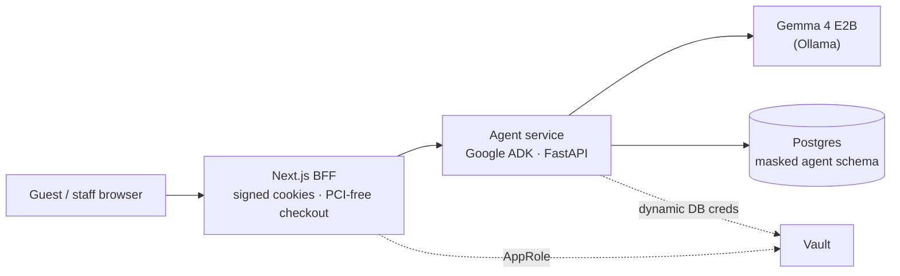

# Solstice Hotel Group: agentic concierge & group-booking PoC

A guest-facing concierge and a group-booking agent for a 140-hotel upper-midscale chain.
It's built for the phData FDE challenge on **Google ADK**, a **self-hosted Gemma 4 E2B**
model, **PostgreSQL**, **HashiCorp Vault**, **Terraform**, and a **Next.js 16** UI.

The design goal is to **optimize for reservation frequency** in two senses:

- **Conversion:** the agent never dead-ends. Every "no" becomes a bookable alternative,
  and a room can be held in one tap.
- **Transactional safety:** inventory can't be oversold, even under concurrent bookings.



| | Result (measured on an RTX 5060 laptop GPU) |
|---|---|
| Concierge single-intent turn | **p50 0.67 s · p95 0.77 s**, right tool in 12/12 scored turns ([latency](docs/latency.md)) |
| Safety / medical / legal message | **≈5 ms**: scripted reply + immediate hand-off, no model involved |
| Group proposal (web form) | **≈1 s** end to end, rooms held if in policy (today: ~2 days) |
| Group proposal (free-text email) | **≈4 s**, LLM extraction verified against the email text |
| Overbooking under 40 concurrent holds for 15 rooms | **exactly 15 succeed** ([test](agent-service/tests/test_policy_and_security.py)) |
| Sample group inquiries matching the answer key | **10/10**, plus 5 rule violations the answer key missed |

## Quick start

**Everything in Docker (Terraform):**

```bash
./infra/up.sh            # or .\infra\up.ps1 on Windows
```

On macOS the containers use the host's Ollama (Docker Desktop has no GPU passthrough), so run
`ollama pull gemma4:e2b` first. See [GPU notes](infra/README.md#gpu-notes).

Open http://localhost:3000. Staff passcode:

```bash
terraform -chdir=infra/terraform/02-apps output -raw staff_passcode
```

**Local dev without Docker** needs Python 3.13 + uv, Node 22+, Ollama with `gemma4:e2b`, and a Postgres superuser:

```bash
cd agent-service    # create .env with SOLSTICE_* settings, all documented in src/solstice_agents/config.py:
                    #   SOLSTICE_DB_PORT, SOLSTICE_ADMIN_DB_USER/PASSWORD (migrations only),
                    #   SOLSTICE_AGENT_DB_USER/PASSWORD, SOLSTICE_STAFF_DB_USER/PASSWORD, SOLSTICE_VAULT_MODE=off
uv run solstice-migrate --create-static-users
uv run solstice-api                          # :8080
cd ../web && npm install && npm run dev      # :3000 (staff passcode: solstice-staff)
```

Tests and sample transcripts:

```bash
cd agent-service && uv run pytest -q                 # 64 tests: rules, PII, least privilege, overbooking race
uv run python scripts/run_transcripts.py             # regenerates agents/transcripts/*.md against the live stack
uv run python scripts/run_group.py                   # regenerates agents/transcripts/group/*.md
```

## What to look at

| Brief asks for | Where it is |
|---|---|
| Guest & staff concierge agent | [`agents/concierge.system.md`](agents/concierge.system.md), [`agent-service/…/agents/concierge.py`](agent-service/src/solstice_agents/agents/concierge.py), UI at `/stay` and `/book` |
| Group booking workflow (agentic) | [`agents/group-workflow.md`](agents/group-workflow.md), [`…/agents/group_workflow.py`](agent-service/src/solstice_agents/agents/group_workflow.py), UI at `/groups` and `/staff/groups` |
| Custom, fit-for-purpose UI | `web/` (stay companion, live workflow pipeline, staff console). [Screenshots](docs/screenshots/) |
| Net-new tools/skills | **Booking Rescue** ([`rules/rescue.py`](agent-service/src/solstice_agents/rules/rescue.py)), **Service Recovery Adjudicator** ([`rules/stay.py`](agent-service/src/solstice_agents/rules/stay.py)), **Intent router + tool-call repair** ([`rules/intent.py`](agent-service/src/solstice_agents/rules/intent.py)). See [`agents/tools.md`](agents/tools.md) |
| System prompts, tools, guardrails | [`agents/`](agents/): [tools](agents/tools.md) · [guardrails](agents/guardrails.md) · [transcripts](agents/transcripts/) |
| Never invent policy / rate / availability | Rules engine + numeric grounding check + data-quality quarantine ([guardrails](agents/guardrails.md)) |
| Group proposals outside the rules go to a human | 15 deterministic checks; flagged proposals arrive with ready-to-approve Rescue options |
| PII never unmasked to the agent | Postgres roles + masked views + input redaction + BFF tokenization ([ADR-0004](docs/adr/0004-pii-least-privilege.md)) |
| Latency target, justified | [`docs/latency.md`](docs/latency.md) |
| Future-state architecture diagram | [`docs/architecture.md`](docs/architecture.md), [`docs/architecture-diagrams.md`](docs/architecture-diagrams.md), live at `/staff/architecture` |
| Integration recommendation (+ "AI is taking our jobs") | [`docs/integration-recommendation.md`](docs/integration-recommendation.md) |
| Assumptions | [`docs/assumptions.md`](docs/assumptions.md) |
| Decisions made along the way | [`docs/adr/`](docs/adr/) |
| Demo walkthrough | [`docs/demo-script.md`](docs/demo-script.md) |

## Repository map

```
agent-service/   Python 3.13 · Google ADK 2.14 · FastAPI · psycopg 3
  src/solstice_agents/
    agents/      concierge (LlmAgent) · group_workflow (ADK Workflow graph)
    rules/       deterministic engines: stay policy, group pricing, Booking Rescue, escalation, intent router
    tools/       ADK function tools (session-scoped, never take a guest_id from the model)
    guardrails.py · services.py · api.py · migrate.py · secrets.py (Vault) · db.py
  tests/         rules vs the CSV answer key, least privilege, overbooking race, PII, triage, router
  scripts/       transcript + group-run generators
agents/          agent configuration (.md): system prompt, tools, guardrails, workflow, transcripts
db/migrations/   roles · core · ops (inventory, holds, cases) · agent surface (masked views, functions)
web/             Next.js 16 (App Router, Cache Components) · Tailwind v4 · BFF route handlers
infra/           Terraform (Docker provider): 01-platform (PG, Vault, Ollama) · 02-apps (Vault config, apps)
docs/            architecture, latency, integration, assumptions, ADRs, screenshots
solstice-data/   the provided sample exports (read-only inputs)
```
