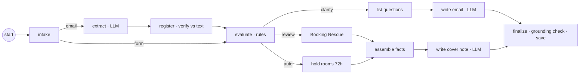

# Group booking workflow: configuration

**Runtime:** ADK 2.x `Workflow` (graph of nodes with routed edges),
[`agents/group_workflow.py`](../agent-service/src/solstice_agents/agents/group_workflow.py).
**LLM:** Gemma 4 E2B, thinking off, temperature 0.2, JSON output schema per LLM node.

| Node | Type | Responsibility |
|---|---|---|
| `intake` | code | Loads a portal inquiry, or redacts PII from a raw email and routes it to extraction |
| `extract` | **LlmAgent** (`output_schema=ExtractedInquiry`) | Free text → fields. Contact details were already removed, so the model never sees them |
| `register` | code | Drops any extracted number not present in the email; decides "approximate" from the text; saves the inquiry |
| `evaluate` | code | 15 checks (below) → `auto_approved` / `needs_review` / `needs_clarification` |
| `rescue_node` | code | Booking Rescue alternatives for flagged requests |
| `hold_block` | code | 72 h courtesy hold for in-policy requests; if inventory races away → `needs_review` |
| `proposal_prompt` / `clarification_prompt` | code | Pre-formatted fact sheet: the only numbers the writer may use |
| `proposal_writer` / `clarification_writer` | **LlmAgent** (`output_schema=CoverNote`) | Prose only |
| `finalize` | code | Rejects the note if any `$` or `%` isn't in the decision → template fallback; persists `ops.group_proposals` with the trace |

## Rule checks (`rules/group.py`)

| Check | Severity | Source |
|---|---|---|
| Required fields (dates, exact room count, room type, meeting headcount) | blocking → clarify | inquiry |
| Dates clear of blackouts | **hard** | `properties.blackout_dates` |
| Inventory for every night | **hard** | `ops.inventory_nights` (net of holds) |
| Meeting capacity | **hard** | `properties.max_meeting_capacity` |
| Block ≤ auto-approve rooms | review | `group_block_auto_approve_max_rooms` |
| Discount ≤ effective ceiling = min(property ceiling, seasonal caps on any night) | review | `max_discount_auto_approve_pct` + rules from notes |
| Lead time (Chicago: > 25 rooms needs ≥ 14 days) | review | property note → rule |
| Route over N rooms (Providence: > 15 → Boston-area sister) | review | property note → rule |
| Published rate exists (not quarantined) | review | data-quality |
| Youth-group insurance certificate (Columbus) | condition | property note → rule |
| Within stated budget; weekend preference (Nashville); off-peak advisory (Phoenix) | advisory | inquiry / notes |

The free-text property notes became structured `core.property_rules` rows **once, with
human review**. They are not interpreted by the model at runtime. Each rule stores an
anchor phrase. If a note changes, the rule isn't loaded, and a data-quality issue asks for
re-review.

## Pricing options

- **As requested:** the client's discount.
- **Confirmable today:** the highest discount inside authority, offered when the request exceeds the ceiling.
- **Budget match:** the smallest whole-percent discount that meets the client's stated budget, if it's within authority (`SOLSTICE_BUDGET_MATCH=true`, [ADR-0003](../docs/adr/0003-reservation-frequency.md)).

Taxes are stated as "plus applicable taxes and fees". No tax rate is in the data, so none is invented.

## Results on the sample inquiries

| Inquiry | Outcome | Flags | Notes |
|---|---|---|---|
| INQ-2001 Harlow & Vance (CHI) | auto-approved, 18 rooms held | — | Budget match 11% → $194.91 ≤ $195 budget |
| INQ-2002 Ridgeline (TPA) | review | block 40 > 35, discount 22% > 15% | Rescue: confirm 15% today; sister properties |
| INQ-2003 Longhorn (AUS) | review | SXSW blackout, **meeting 250 > 220** | Answer key missed the capacity issue |
| INQ-2004 Meridian (DEN) | clarify | — | Asks for dates, exact count, room mix, AV headcount, budget, phone |
| INQ-2005 Cascade (SAC) | review | meeting 300 > 140, **block 22 > 20** | Rescue: properties seating ≥ 300 or off-site venue |
| INQ-2006 Blue Anchor (PVD) | auto-approved, **urgent** | — | "THIS WEEK" → priority queue |
| INQ-2007 OSU Alumni (PVD) | review | route > 15, block > 15 | Rescue: 15 now + 5 routed to Boston sister (not in directory → sales) |
| INQ-2008 Buckeye Band (CMH) | review + condition | **block 28 > 20, discount 12% > 10%** | Insurance certificate required; answer key mentioned only the insurance |
| INQ-2009 Camelback (PHX) | review | discount 17% > 15% only | Flags only the actual problem; "confirm at 15% today" |
| INQ-2010 Policy Forum (SAC) | review | **blackout 05-03..07**, discount 10% > 8% seasonal | Answer key missed the blackout |

Full runs with traces, rule tables and LLM-written notes: [`transcripts/group/`](transcripts/group/).
