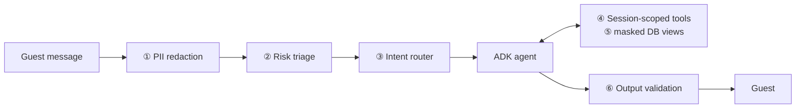

# Guardrails

Principle: **a guardrail that depends on the model behaving isn't a guardrail.** Every
control below is enforced in code or in the database, and each one is covered by a test or
a sample transcript.

| # | Guardrail | Where | What it stops | Evidence |
|---|---|---|---|---|
| ① | **PII redaction on input**: Luhn-checked card numbers, CVV, SSN, email, phone, removed *before* the model, logs or DB see them | `guardrails.redact_pii`, API entry | Card numbers pasted into chat reaching the LLM context or transcripts | transcript 09, `test_redacts_real_card_numbers_only` |
| ② | **Deterministic risk triage**: safety, medical, legal and media keywords bypass the LLM entirely, return a scripted reply (911 guidance) and open an *immediate* case to the GM + Regional Security | `rules/escalation.triage` | A 2B model missing an emergency | transcript 08 (≈5 ms), `test_triage` |
| ③ | **Intent router + tool-call repair**: unambiguous asks are routed in code; replies that skip the needed tool are replaced by the tool call | `rules/intent.py`, `after_model_callback` | "Say–do gap": claiming an action that didn't happen | `test_intent.py`, transcripts show 🧭 |
| ④ | **Session-scoped tools**: no tool accepts a guest ID; reservation ownership is checked server-side | `tools/concierge_tools.py` | Prompt injection reading other guests' data | transcript 10, `test_verify_requires_matching_last_name` |
| ⑤ | **Least-privilege data access**: the agent's Postgres user (Vault-issued, 1 h TTL) can only SELECT masked `agent.*` views and call narrow functions. No access to `core.*`, card data, or the eval answer key | `db/migrations/003_agent_surface.sql` | Any code path, even a compromised one, exposing raw PII | `test_agent_role_cannot_read_raw_pii`, `test_agent_view_is_masked` |
| ⑥a | **Numeric grounding**: every `$`, `%` and clock time in a reply must appear in this turn's tool output, the session context, or the guest's message; otherwise the reply is replaced with a safe fallback + hand-off offer | `after_model_callback` → `guardrails.ungrounded_figures` | Invented rates, fees, discounts, times | `test_ungrounded_figures` |
| ⑥b | **Staff-note leak detection**: internal front-desk notes guide the agent (e.g. "promo expired, don't apply") but any 7-word verbatim overlap in a reply is blocked | `guardrails.leaks_staff_notes` | Quoting internal notes, VIP flags, other guests' IDs | `test_staff_note_leak`, transcript 11 |
| ⑥c | **PII on output + placeholder scrub**: redacts any PII the model emits; removes template placeholders like "[Guest Name]" | `after_model_callback` | PII echoes, "Dear [Name]" | |
| ⑦ | **Human-in-the-loop for money and irreversible actions**: the agent never cancels, refunds, comps or adjusts a folio. Cancellation needs the guest's explicit confirm button; refunds and comps go to staff with a pre-adjudicated case | tool design | Unauthorized financial actions | `cancellation_options` has no side effects |
| ⑧ | **Group rules can't be overridden by the LLM**: discount ceilings (incl. seasonal caps), block limits, blackouts, capacity, lead time and property-specific rules are evaluated in code; anything outside → `needs_review` | `rules/group.py` | Auto-approving out-of-policy proposals | `test_group_rules.py` (10/10 inquiries) |
| ⑨ | **LLM extraction verified against the source**: for emailed inquiries, every number the model extracts must appear in the (PII-redacted) email; "approximate" is decided by code | `group_workflow.register` | Hallucinated room counts or discounts | INQ-3003 trace |
| ⑩ | **Data-quality quarantine**: impossible source values (Providence suite rate −$395) are nulled at ingestion and logged; the agent cannot quote them and escalates instead | `migrate.Seeder` | Garbage in → confident garbage out | `/staff/metrics` → data quality |
| ⑪ | **Payment isolation**: card data is entered only in secure checkout; the BFF keeps the last 4 digits and discards the rest (production: provider-hosted fields, PCI SAQ-A) | `web/src/app/api/checkout/route.ts` | PAN in agent context, DB or logs | |
| ⑫ | **Overbooking prevention**: row-locked holds, a `CHECK (sold + held <= capacity)` constraint, idempotency keys, TTL expiry | `002_ops.sql` | Two guests getting the last room | `test_no_overbooking_under_concurrent_holds` |

Every activation is written to `ops.guardrail_events` and shown on `/staff/metrics`.
