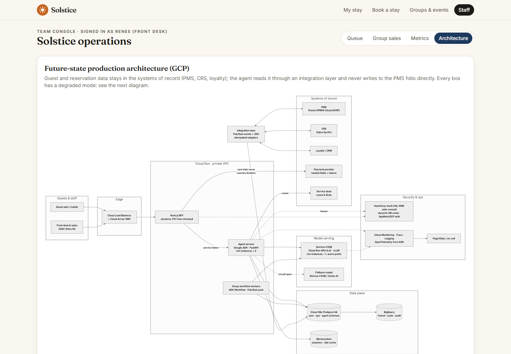

# Architecture

**Diagrams:** [`architecture-diagrams.md`](architecture-diagrams.md), generated from
`web/src/lib/diagrams.ts`, the same source the staff console renders live at
`/staff/architecture`. Six mermaid diagrams: future-state production, graceful
degradation, a concierge turn sequence, the group workflow graph, data/PII boundaries,
and the PoC stack.

## 1. PoC (what runs today)

Two Terraform stages on the Docker provider ([infra/README.md](../infra/README.md)):

- **01-platform:** Postgres 18, Vault (dev mode), Ollama serving `gemma4:e2b` (a GPU
  container, or the host GPU when Docker can't pass the GPU through).
- **02-apps:** Vault configuration (KV, the database secrets engine, AppRole, policies),
  a one-shot migrate job (schema + validated CSV seed), the agent service, and the web app.

The agent service never holds a long-lived database password. It logs in to Vault with
AppRole and receives a Postgres user that expires in an hour (`v-approle-solstice-…`) and
belongs to the `solstice_agent` group role, which can only see masked views.

## 2. Future state (production on GCP)

### Where guest and reservation data comes from

Solstice's systems of record stay the systems of record. The agent platform keeps an
**operational read model** plus the data it owns (holds, cases, requests, proposals,
metrics). It isn't a second PMS.

| Domain | System of record (typical for an upper-midscale chain) | How the agent gets it | Writes back |
|---|---|---|---|
| Stays, folios, room status | PMS: Oracle OPERA Cloud via **OHIP** REST APIs + business events | Event stream (Pub/Sub) → read model, refreshed on change; on-demand API reads for "right now" questions | Late-checkout/upgrade requests as **PMS traces/messages** for the desk; never folio postings |
| Availability, rates, bookings | CRS: e.g. Sabre SynXis | Availability/rate API with a short-TTL cache | Holds → CRS allocations; bookings → CRS reservation create (idempotency keys) |
| Loyalty tier, points | Loyalty/CRM platform | Profile API, cached per session | Goodwill-points *requests* to the desk, not direct credits |
| Groups | Sales & Catering (OPERA S&C or equivalent) | Inquiry intake from the web portal or email | Approved blocks created in S&C by the adapter after human review |
| Policies | Brand standards / front-desk reference | Versioned documents → full-text index (as in the PoC) | — |

### Where the agent runs

- **Cloud Run** (private VPC, internal ingress) for the Next.js BFF, the agent service
  (min instances 2), and group-workflow workers (Pub/Sub push).
- **Model serving:** Gemma 4 E2B on **Cloud Run GPU (L4)** with vLLM (continuous
  batching, automatic prefix caching), min instances 1, with the prompt prefix warmed on
  start. Concierge and group workloads get **separate replicas**, so their prompt caches
  don't evict each other ([latency.md](latency.md)). A larger fallback (Gemma 4 E4B or
  Vertex AI) sits behind a circuit breaker.
- **Cloud SQL Postgres (HA)** keeps the same three-schema design (`core` / `ops` / `agent`)
  and role model; **Memorystore** holds sessions and rate caches; **BigQuery** holds the
  funnel, eval results, and the audit export.
- **Vault HA** (Raft storage, cloud-KMS auto-unseal) with GCP auth instead of AppRole
  secret IDs. Dynamic database credentials work exactly as in the PoC.

### How it's monitored

| Signal | Source | Alert / use |
|---|---|---|
| Turn latency p50/p95 by path | `ops.turn_metrics` → OpenTelemetry → Cloud Monitoring | SLO p95 ≤ 2.5 s, burn-rate alert |
| Containment rate, escalation rate by category | funnel events | Weekly ops review; a spike in one category = a policy or tool gap |
| Guardrail activations (repairs, blocked replies, PII redactions, injection attempts) | `ops.guardrail_events` | Rising repairs = a model or prompt regression |
| Tool error rate per upstream (PMS, CRS, DB) | `_safe()` tool wrapper | Page on-call when it breaches; drives the circuit breaker |
| Reservation funnel (sessions → availability → holds → bookings), Rescue acceptance | funnel events → BigQuery | The business KPI this PoC optimizes |
| Case SLA (time to acknowledge / resolve) | `ops.escalations` | Overdue immediate cases page the MOD |
| Offline evals | CI runs `pytest` (group answer key, policy rules, red-team prompts) + transcript replay on every prompt/model change | Gate deploys; compare tool accuracy and latency against the previous version |

Traces cover a full turn: BFF → router → each LLM call → each tool → guardrails, with
redacted payloads. Logs never contain raw PII, because redaction runs before logging.

### How it degrades when something upstream fails

| Failure | Behaviour | Guest experience |
|---|---|---|
| Model slow (> timeout) or down | Health probe trips; the turn falls back to **degraded mode**: policy full-text search + one-tap actions; circuit breaker to the fallback model | "Our assistant is in limited mode — here's the policy; the buttons still work" |
| PMS / CRS API down | Tools return "system unavailable"; reads served from the read model with an "as of" time; writes go to an **outbox** and replay idempotently | "I've logged your request; the desk will confirm" — never a guessed answer |
| Postgres down | BFF serves a static help page with the property phone number; no partial writes | Explicit outage message |
| Vault unreachable | Existing leases keep working until TTL; renewals retry; a new instance can't start (fail closed) | No impact for the lease TTL (1 h) |
| Staff console or service desk down | Cases queue in Pub/Sub; the guest still gets a case number and expected response time | Unchanged |
| Safety-critical message at any time | Bypasses the model entirely (regex triage) | 911 guidance + immediate GM/Security case |

## 3. Security model in one paragraph

Identity is a signed httpOnly cookie held by the BFF. The browser never talks to the agent
service, and the agent service trusts only the BFF's service token, which comes from
Vault. Tools derive the guest from the session, never from the model. The database
enforces what the agent can read (masked views) and write (narrow SECURITY DEFINER
functions). Card numbers stop at the checkout boundary (production: provider-hosted
fields). Every control is listed in [agents/guardrails.md](../agents/guardrails.md).
