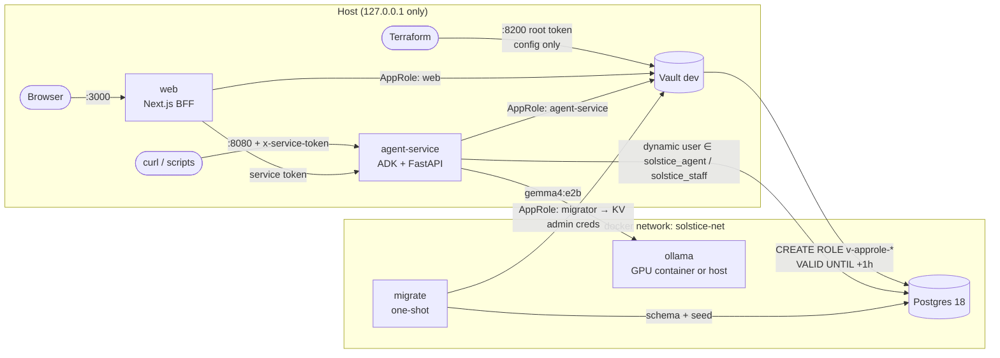

# Solstice local stack (Terraform + Docker + Vault)

One command brings up the whole PoC: Postgres, Vault, Gemma 4 E2B on Ollama, the
schema migration job, the ADK agent service and (optionally) the Next.js web app.



## Run it

```bash
./infra/up.sh                     # bash (Git Bash / Linux / macOS)
```
```powershell
.\infra\up.ps1                    # Windows PowerShell
```

Override any variable with `TF_VAR_*`:

| Variable | Default | Stage | Purpose |
|---|---|---|---|
| `TF_VAR_agent_port` | `8080` | 2 | Agent API on 127.0.0.1 |
| `TF_VAR_web_port` | `3000` | 2 | Web app on 127.0.0.1 |
| `TF_VAR_enable_web` | `true` | 2 | Build and run the Next.js container |
| `TF_VAR_vault_port` | `8200` | 1 | Vault API/UI on 127.0.0.1 |
| `TF_VAR_ollama_mode` | auto | 1 | `container` (GPU) or `host`. The up scripts auto-detect GPU support |
| `TF_VAR_ollama_models_dir` | `C:/Users/joshu/.ollama/models` | 1 | Host model cache, mounted read-only into the Ollama container |
| `TF_VAR_docker_host` | `npipe:////./pipe/dockerDesktopLinuxEngine` | 1+2 | Use `unix:///var/run/docker.sock` on Linux/macOS |
| `TF_VAR_db_cred_ttl_seconds` | `3600` | 2 | Lease TTL of Vault-issued Postgres users |

Example on non-default ports, which is how the stack was verified:

```bash
TF_VAR_vault_port=18200 TF_VAR_agent_port=18080 TF_VAR_web_port=13000 ./infra/up.sh
export SOLSTICE_SERVICE_TOKEN=$(terraform -chdir=infra/terraform/02-apps output -raw service_token)
curl -s localhost:18080/health      # {"db":true,"model":true,...,"vault_mode":"dynamic"}
(cd agent-service && uv run python scripts/run_transcripts.py --base http://localhost:18080 --only 03)
```

Tear down (same `TF_VAR_*` values; removes the Postgres volume): `./infra/down.sh`

## Why two stages

The Vault provider can only be configured once Vault is running, and Terraform configures
providers before it creates resources. So:

1. **`terraform/01-platform`**: network `solstice-net`, Postgres (not published to the host),
   Vault in dev mode, Ollama. It generates the Postgres admin password and the Vault root token,
   and exposes them only as sensitive outputs.
2. **`terraform/02-apps`**: reads stage 1 through `terraform_remote_state`, configures Vault, builds
   the agent image from the repo, runs the `migrate` job (Terraform waits for it and fails if
   it exits non-zero), then starts `agent-service` and, if enabled, `web`.

Both stages are idempotent: a second `up` is a no-op.

## Secret flow (who can see what)

| Secret | Lives in | Readable by |
|---|---|---|
| Vault root token | stage-1 state (sensitive output) | Terraform only, for configuration |
| Postgres admin password | KV `secret/solstice/migrator` + Vault DB connection | `migrator` AppRole, Vault's DB engine |
| Agent DB login | **minted per instance** by `database/creds/solstice-agent` | `agent-service` AppRole |
| Staff DB login | **minted per instance** by `database/creds/solstice-staff` | `agent-service` AppRole (staff console endpoints) |
| BFF ↔ agent service token | KV `secret/solstice/agent-service`, `secret/solstice/web` | `agent-service`, `web` AppRoles |
| Web session-cookie secret | KV `secret/solstice/web` | `web` AppRole |

**Dynamic database credentials.** When the agent service starts, it logs in with its AppRole
and asks Vault for two Postgres users. Vault runs:

```sql
CREATE ROLE "v-approle-solstice-…" WITH LOGIN PASSWORD '…' VALID UNTIL '<now+1h>' INHERIT;
GRANT solstice_agent TO "v-approle-solstice-…";   -- or solstice_staff
```

The service renews the lease at TTL/2. If renewal fails, it requests new credentials and swaps its
connection pool (`agent-service/src/solstice_agents/db.py`). When a lease ends, Vault revokes it
and drops the user. No database password is long-lived, stored on disk, or shared between instances.
Each login is traceable to one service instance. Postgres `pg_stat_activity` shows only `v-approle-*` users.

**Policies.** Each AppRole has exactly one policy (`02-apps/vault.tf`):

```hcl
# solstice-agent-service
path "secret/data/solstice/agent-service" { capabilities = ["read"] }
path "database/creds/solstice-agent"      { capabilities = ["read"] }
path "database/creds/solstice-staff"      { capabilities = ["read"] }
path "sys/leases/renew"                   { capabilities = ["update"] }
# solstice-migrator
path "secret/data/solstice/migrator"      { capabilities = ["read"] }
# solstice-web
path "secret/data/solstice/web"           { capabilities = ["read"] }
```

Verified: the agent-service AppRole gets `403 Forbidden` reading `secret/solstice/migrator`.

## Local-only shortcuts, and what production does instead

| Local stack | Production |
|---|---|
| Vault **dev mode** (in-memory, auto-unsealed). A Vault restart wipes its config, so re-run `up` | Vault cluster with **Integrated Storage (Raft) HA**, 3–5 nodes, **auto-unseal via cloud KMS** (GCP KMS / AWS KMS), audit devices on, TLS everywhere |
| AppRole `secret_id` passed as a container env var | **Platform identity**: GCP / AWS IAM or Kubernetes auth, so no secret is bootstrapped, or a **response-wrapped** single-use `secret_id` delivered by the orchestrator |
| Root token held in Terraform state | Root token revoked after bootstrap. Terraform runs with a scoped admin policy; remote state is encrypted with locking |
| Postgres admin password in KV for the migrator | Rotate the DB connection's root credential (`database/rotate-root/solstice-postgres`) and run migrations from CI with their own short-lived role |
| `sslmode=disable` on the private Docker network | TLS to Postgres (Cloud SQL / RDS) with verified certificates |
| Ports bound to 127.0.0.1 | Private networking, an internal load balancer for the agent service, the web app behind a WAF/CDN |

## GPU note (this machine)

`ollama_mode=container` passes the NVIDIA GPU into the Ollama container (`gpus = "all"`). On
Windows that requires **Docker Desktop's WSL2 backend** plus the NVIDIA driver. This machine runs Docker
Desktop on the **Hyper-V backend**, where `docker run --gpus all` fails with
`nvidia-container-cli: … libnvidia-ml.so.1: cannot open shared object file`. The up scripts
detect this and fall back to `ollama_mode=host`: containers reach the host's GPU-backed
Ollama at `host.docker.internal:11434`. To use the containerized Ollama, switch Docker Desktop to
the WSL2 engine (Settings → General → "Use the WSL 2 based engine"), then re-run `up`.

## Troubleshooting

- **`docker logs solstice-migrate`**: migration and seed output (the job also prints it as a Terraform output).
- **Agent health:** `curl localhost:<agent_port>/health` returns `db`, `model`, `model_warm` and `vault_mode`.
- **Who is connected to Postgres:** `docker exec solstice-postgres psql -U postgres -d solstice -c "select usename, application_name from pg_stat_activity where usename like 'v-%'"`
- **Vault UI:** `http://127.0.0.1:<vault_port>/ui`, root token from `terraform -chdir=infra/terraform/01-platform output -raw vault_root_token`.
